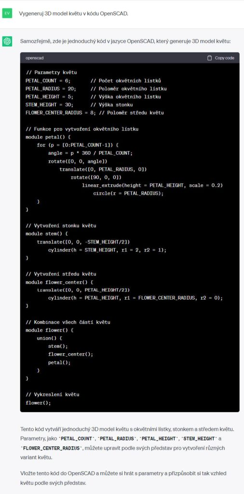
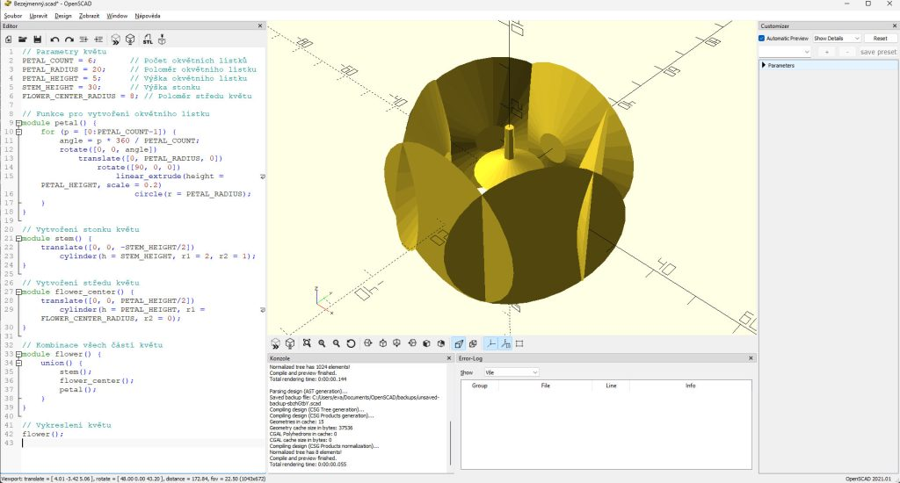
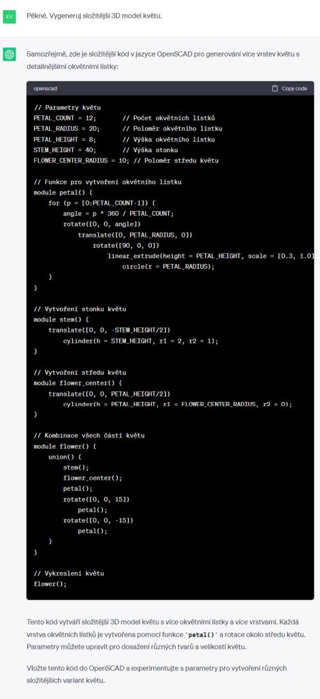
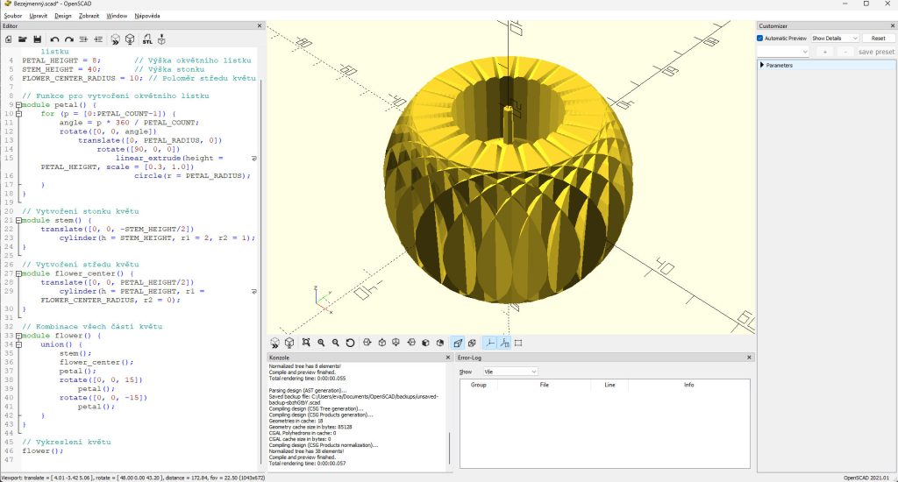
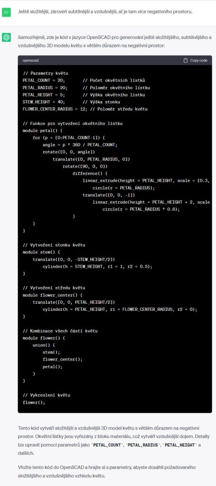
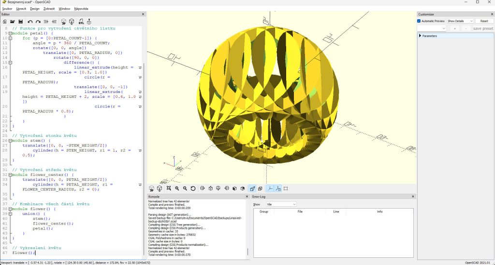

## Prompt

```text
Vygeneruj 3D model [květu] v kódu OpenSCAD.
```

## Tipy

Aplikace [Openscad](https://openscad.org/) slouží k navrhování 3D objektů pomocí kódu. Je zdarma, instaluje se.

Při generování objektů je dobré začít velmi obecným promptem a dotvářet objekt postupnou iterací — ale stále velmi obecnou. Pokusy popisovat přesně, co má ChatGPT vygenerovat, většinou selhaly.



Takto vypadá výsledek:



Nyní chceme, aby ChatGPT vygeneroval složitější model:



Výsledek:



Přejem si subtilnější a složitější model květu:



Výsledek:



> Starší prompt z roku 2024. Chatboti od té doby umí mnohem víc — výsledek bude jiný než na původních ukázkách.

**Dnes už i jako aplikace:** podívejte se, jak podobnou vizualizaci postavit přímo v chatbotu — [Vibe coding: materiály do výuky](/vibe-coding/materialy-do-vyuky).
