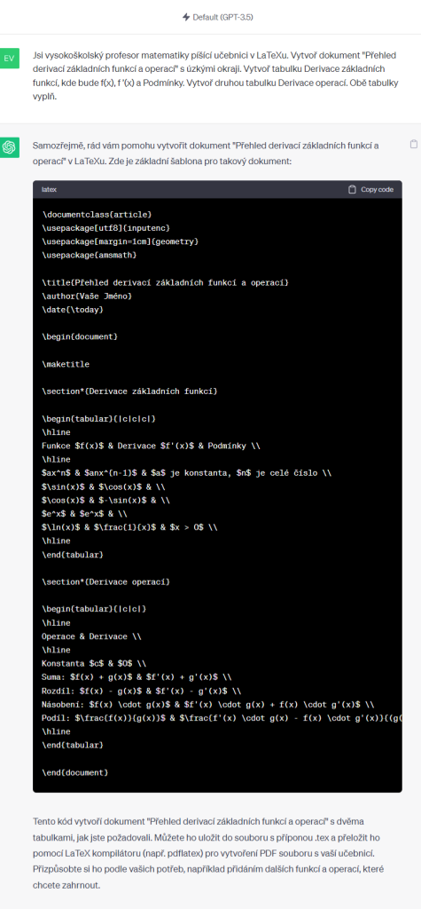
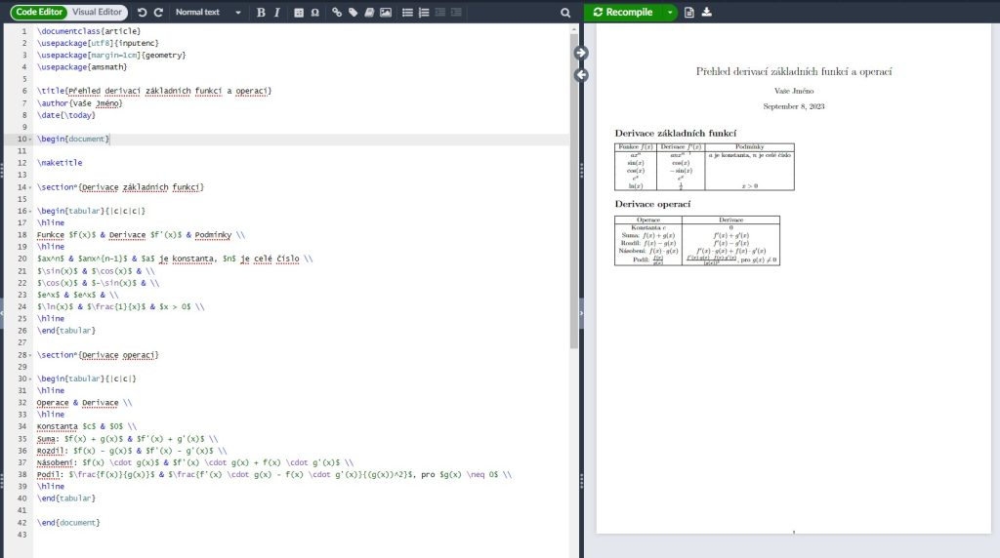

## Prompt

```text
Jsi vysokoškolský profesor matematiky píšící učebnici v LaTeXu. Vytvoř dokument „Přehled derivací základních funkcí a operací“ s úzkými okraji. Vytvoř tabulku Derivace základních funkcí, kde bude f(x), f ’(x) a Podmínky. Vytvoř druhou tabulku Derivace operací. Obě tabulky vyplň.
```

## Tipy

Efektivita ChatGPT roste spolu s využitím dalších aplikací. Jedna z nich je například [Overleaf](https://www.overleaf.com/), díky níž můžete vytvářet dokumentu v kódu LaTeX.

ChatGPT dělá často v podobných úlohách chyby. Proto takto vytvořený materiál v hodinách může sloužit žákům/studentům k tomu, aby určovali, zda udělal ChatGPT při psaní dokumentu chyby, a pokud ano, je označili a opravili.

Vložte prompt do ChatGPT:



Zkopírujte kód pomocí příkazu „Copy code“ a přejděte  do aplikace [Overleaf](https://www.overleaf.com/). V aplikaci je nutné se zaregistrovat pomocí e-mailové adresy. Vytvořte nový projekt a do levého okna vložte kód.



Autorem promptu je Vítek Boček.

> Starší prompt z roku 2024. Chatboti od té doby umí mnohem víc — výsledek bude jiný než na původních ukázkách.

**Dnes už i jako aplikace:** podívejte se, jak podobnou vizualizaci postavit přímo v chatbotu — [Vibe coding: materiály do výuky](/vibe-coding/materialy-do-vyuky).
