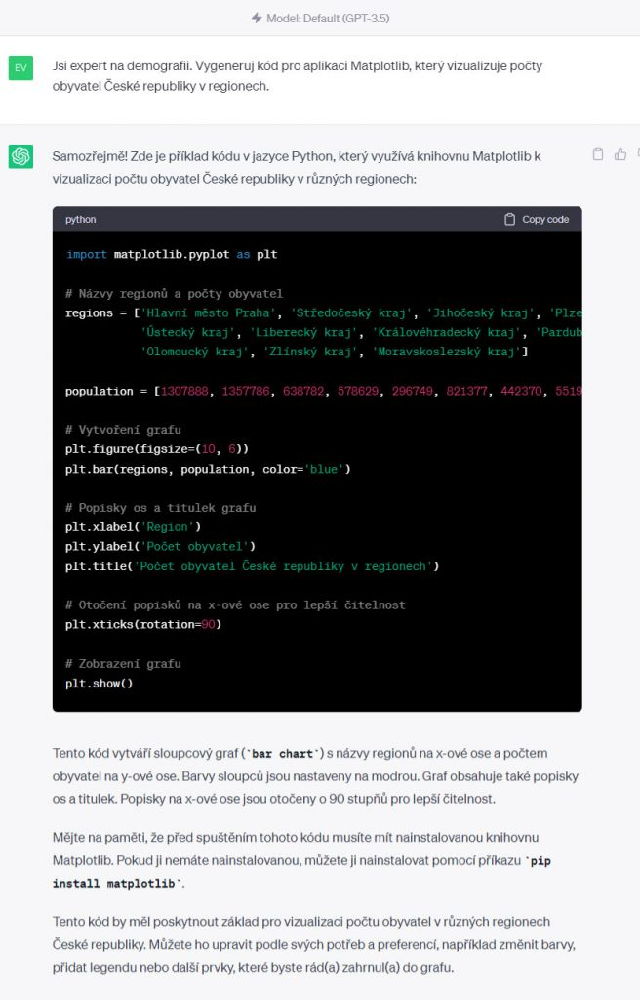
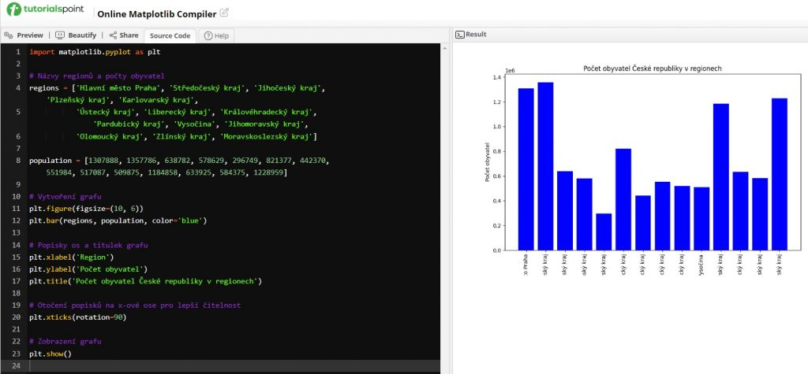

## Prompt

```text
Jsi expert na [demografii]. Vygeneruj kód pro aplikaci Matplotlib, který vizualizuje [počty obyvatel České republiky v regionech].
```

## Tipy

Efektivita ChatGPT roste spolu s využitím dalších aplikací. Jedna z nich je například [Matplotlib](https://www.tutorialspoint.com/execute_matplotlib_online.php), která slouží k vizualizaci různých typů dat.

Vložte prompt do ChatGPT:



Zkopírujte kód pomocí příkazu „Copy code“ a přejděte  do aplikace [Matplotlib](https://www.tutorialspoint.com/execute_matplotlib_online.php). Tam kód vložte do levého sloupce a stiskněte tlačítko „Preview“.



Můžete vyzkoušet generovat i další grafy. Jejich příklady najdete [zde](https://matplotlib.org/stable/gallery/index).

> Starší prompt z roku 2024. Chatboti od té doby umí mnohem víc — výsledek bude jiný než na původních ukázkách.

**Dnes už i jako aplikace:** podívejte se, jak podobnou vizualizaci postavit přímo v chatbotu — [Vibe coding: materiály do výuky](/vibe-coding/materialy-do-vyuky).
