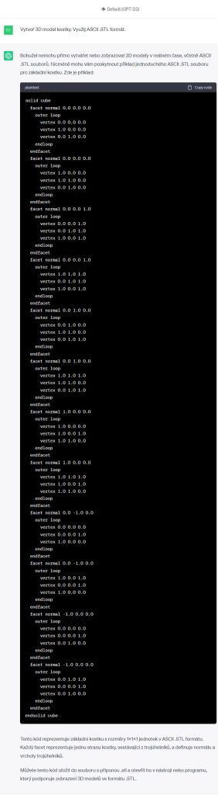
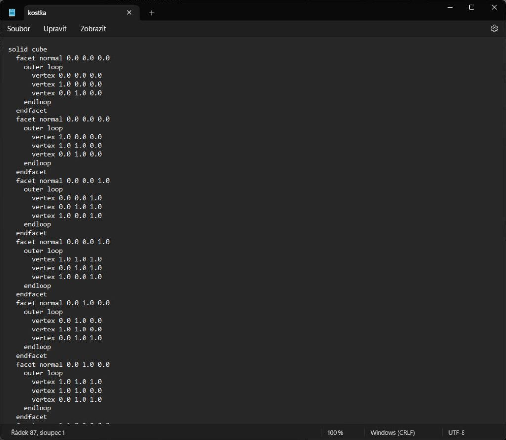
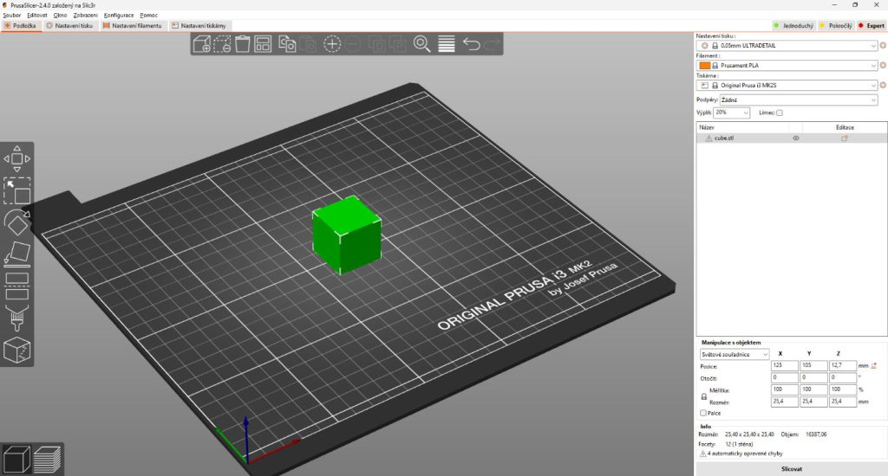

## Prompt

```text
Vytvoř 3D model [kostky]. Využij ASCII .STL formát.
```

## Tipy

ChatGPT dokáže generovat také kódy různých formátů souborů a .STL je standardní formát, do kterého se ukládají 3D modely. Tímto způsobem ale  zatím nedokáže vytvořit složitější 3D objekt.

Vložte prompt do ChatGPT:



Zkopírujte kód a vložte ho do Poznámkového bloku:



Poté soubor uložte a přepište jeho příponu z .TXT na .STL. Takto pak vypadá vygenerovaná kostka, kterou můžete připravit pro tisk například v PRUSA Sliceru.



> Starší prompt z roku 2024. Chatboti od té doby umí mnohem víc — výsledek bude jiný než na původních ukázkách.

**Dnes už i jako aplikace:** podívejte se, jak podobnou vizualizaci postavit přímo v chatbotu — [Vibe coding: materiály do výuky](/vibe-coding/materialy-do-vyuky).
