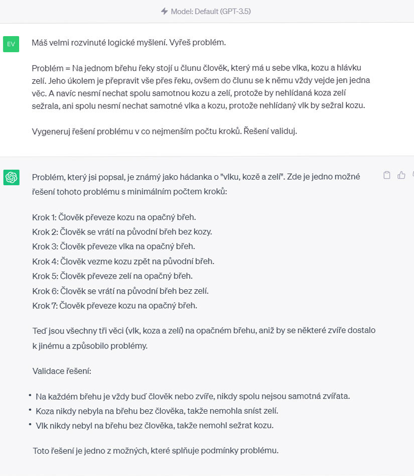
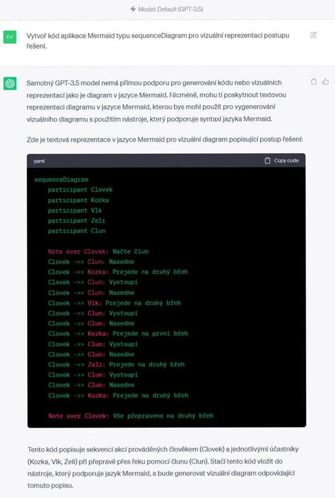
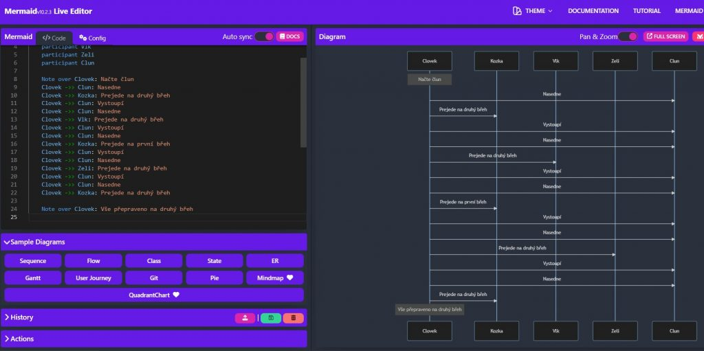
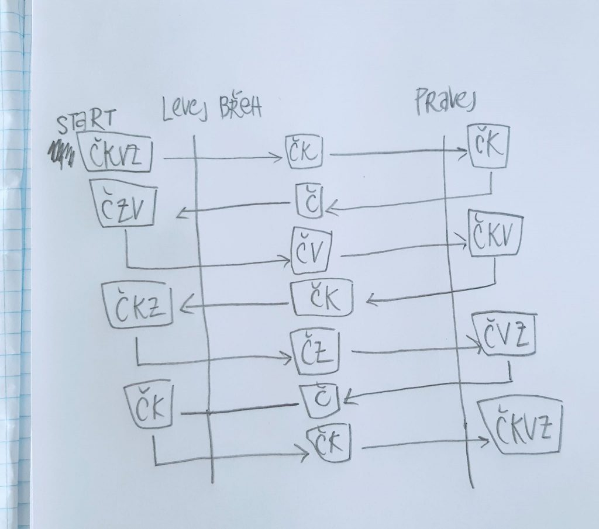

## Prompt č. 1

```text
Máš velmi rozvinuté logické myšlení. Vyřeš problém.

Problém = Na jednom břehu řeky stojí u člunu člověk, který má u sebe vlka, kozu a hlávku zelí. Jeho úkolem je přepravit vše přes řeku, ovšem do člunu se k němu vždy vejde jen jedna věc. A navíc nesmí nechat spolu samotnou kozu a zelí, protože by nehlídaná koza zelí sežrala, ani spolu nesmí nechat samotné vlka a kozu, protože nehlídaný vlk by sežral kozu.

Vygeneruj řešení problému v co nejmenším počtu kroků. Řešení validuj.
```

## Prompt č. 2

```text
Vytvoř kód aplikace Mermaid typu „sequenceDiagram“ pro vizuální reprezentaci postupu řešení.
```

## Tipy

Vložte prompt do ChatGPT:



Efektivita ChatGPT roste spolu s využitím dalších aplikací. Jedna z nich je například [Mermaid](https://mermaid.live/), díky níž můžete vytvářet různé diagramy, jako například koláčový graf, ganntův diagram apod. Diagramy se vytváří (kódují) pomocí kódu Mermaid, který ChatGPT poměrně dobře zvládá.



Zkopírujte kód pomocí příkazu „Copy code“ a přejděte  do aplikace [Mermaid](https://mermaid.live/). Tam kód vložte do levého sloupce:



Zajímavý přístup může být také takový, že si nejprve nakreslíte ideální diagram sami a pak se ho snažíte co nejpřesněji aplikaci ChatGPT popsat. Můžete vyzkoušet také generovat sekvenci v další aplikacích:  [Nomnoml](https://www.nomnoml.com/), [Matplotlib](https://www.tutorialspoint.com/execute_matplotlib_online.php) nebo  [D2](https://play.d2lang.com/).

Možnost znázornění postupu řešení úlohy:



> Starší prompt z roku 2024. Chatboti od té doby umí mnohem víc — výsledek bude jiný než na původních ukázkách.

**Dnes už i jako aplikace:** podívejte se, jak podobnou vizualizaci postavit přímo v chatbotu — [Vibe coding: materiály do výuky](/vibe-coding/materialy-do-vyuky).
