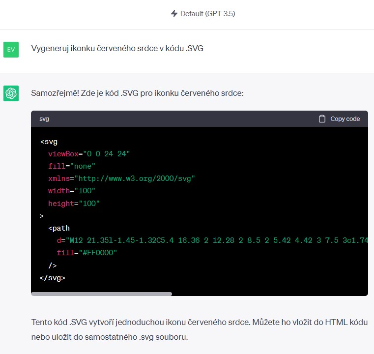
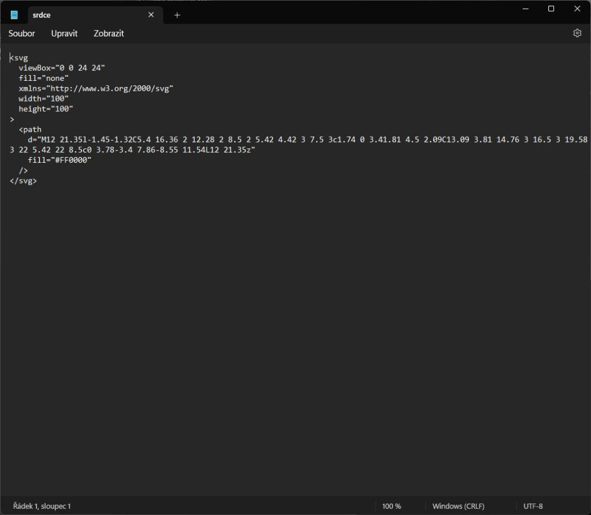

## Prompt

```text
Vygeneruj ikonku [červeného srdce] v kódu .SVG
```

## Tipy

ChatGPT dokáže generovat také kódy různých formátů souborů a .SVG je standardní formát, do kterého se ukládají vektorové obrázky. Tímto způsobem ale zatím nedokáže vytvořit nic složitějšího.

Vložte prompt do ChatGPT:



Zkopírujte kód a vložte ho do Poznámkového bloku:



Poté soubor uložte a přepište jeho příponu z .TXT na .SVG. Takto pak vypadá vygenerovaná ikonka srdce. Zobrazit si ji můžete v libovolném internetovém prohlížeči.


> Starší prompt z roku 2024. Chatboti od té doby umí mnohem víc — výsledek bude jiný než na původních ukázkách.

**Dnes už i jako aplikace:** podívejte se, jak podobnou vizualizaci postavit přímo v chatbotu — [Vibe coding: materiály do výuky](/vibe-coding/materialy-do-vyuky).
