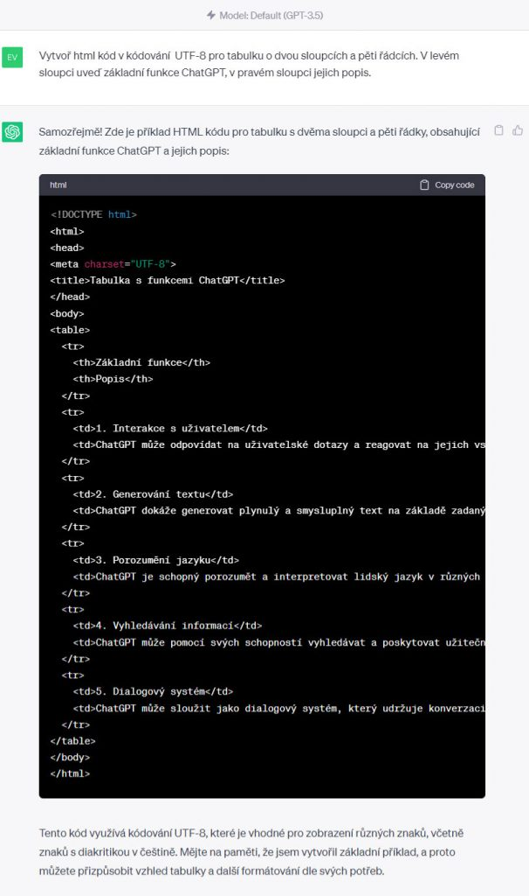
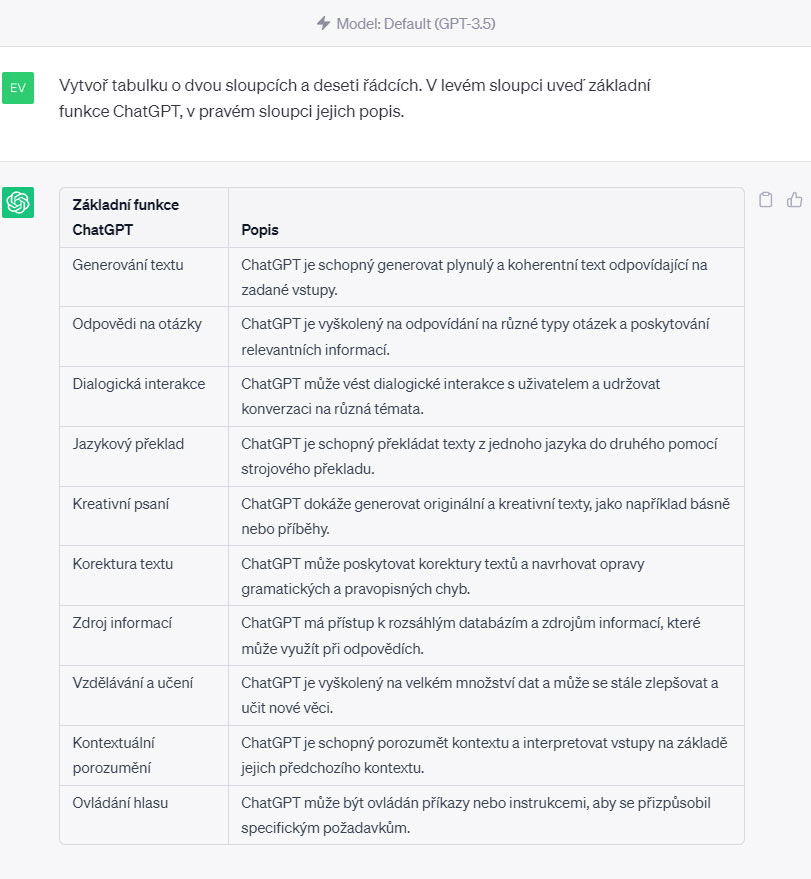

## Prompt

```text
Vytvoř tabulku o dvou sloupcích a deseti řádcích. V levém sloupci uveď [základní funkce ChatGPT], v pravém sloupci [jejich popis].
```

## Prompt

```text
Vytvoř html kód v kódování  UTF-8 pro tabulku o dvou sloupcích a pěti řádcích. V levém sloupci uveď [základní funkce ChatGPT], v pravém sloupci [jejich popis].
```

## Tipy



ChatGPT dokáže generovat tabulky přímo v rozhraní aplikace.

Vložte prompt do ChatGPT:



Zároveň můžete ChatGPT požádat o vygenerování html kódu pro tabulku, pokud ji chcete využít jako text. Vložte prompt:

Zde je vložen html kód vygenerovaný v ChatGPT:

Tabulka s funkcemi ChatGPT

Základní funkce
Popis

1. Interakce s uživatelem
ChatGPT může odpovídat na uživatelské dotazy a reagovat na jejich vstupy.

2. Generování textu
ChatGPT dokáže generovat plynulý a smysluplný text na základě zadaných vstupů nebo podnětů.

3. Porozumění jazyku
ChatGPT je schopný porozumět a interpretovat lidský jazyk v různých kontextech a odpovídat s porozuměním.

4. Vyhledávání informací
ChatGPT může pomocí svých schopností vyhledávat a poskytovat užitečné informace uživatelům.

5. Dialogový systém
ChatGPT může sloužit jako dialogový systém, který udržuje konverzaci a poskytuje relevantní odpovědi.

> Starší prompt z roku 2024. Chatboti od té doby umí mnohem víc — výsledek bude jiný než na původních ukázkách.

**Dnes už i jako aplikace:** podívejte se, jak podobnou vizualizaci postavit přímo v chatbotu — [Vibe coding: materiály do výuky](/vibe-coding/materialy-do-vyuky).
