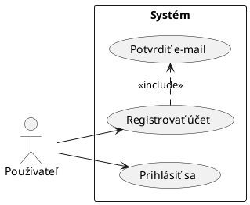
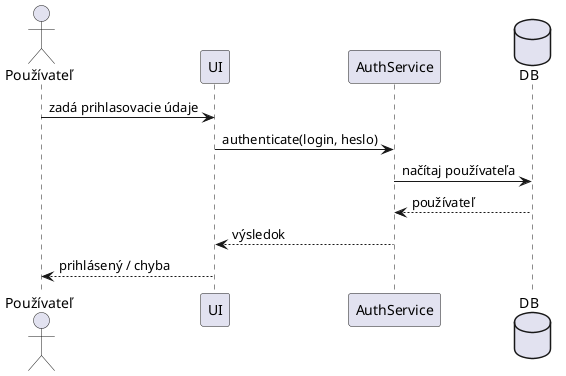
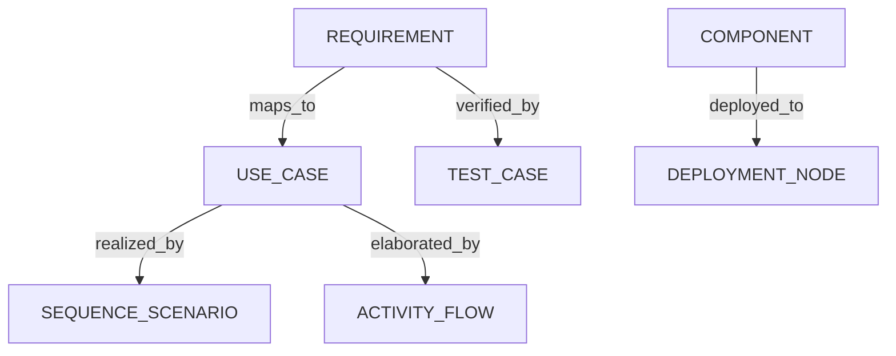

# Notácia UML: najlepšie postupy, tipy na aplikáciu, druhy diagramov a prípady ich použitia

## Výkonné zhrnutie

UML je štandardizovaný vizuálny modelovací jazyk spravovaný organizáciou OMG, určený na špecifikáciu, vizualizáciu, konštrukciu a dokumentáciu softvérových aj iných systémov. K júnu 2026 OMG stále uvádza ako aktuálnu formálnu verziu UML 2.5.1 z decembra 2017; zároveň existuje aktivita „UML 2.6 Revision Task Force“, ale nie samostatne publikovaná nová formálna verzia štandardu. OMG zároveň publikuje nielen PDF špecifikáciu, ale aj normatívne strojovo čitateľné artefakty, napríklad XMI pre metamodel, štandardný profil a diagram interchange, čo je dôležité pre interoperabilitu nástrojov.[^1]

Pre prax je podstatné rozlíšiť, že UML nie je vývojová metodika ani náhrada za kód. Je to jazyk a súbor pohľadov na systém. Najvyššiu návratnosť v bežných projektoch mávajú diagramy prípadov použitia, tried, sekvenčné diagramy, diagramy aktivít, stavové diagramy, komponentové a nasadzovacie diagramy; ostatné diagramy sú veľmi užitočné, ale častejšie vo chvíli, keď riešiš konkrétny architektonický alebo analytický problém. Empirické štúdie aj priemyselná prax ukazujú, že UML sa v organizáciách používa selektívne a účelovo, nie ako „modelovať všetko“.[^2]

Z hľadiska kvality modelov sú najdôležitejšie štyri veci: modelovať len to, čo nesie rozhodovaciu hodnotu; držať konzistentné pomenovanie a rozloženie; udržať primeranú úroveň detailu; a zabezpečiť nadväznosť medzi požiadavkami, návrhom, testami a prípadne kódom. Výskum naznačuje, že kvalita rozloženia aj úroveň detailu majú merateľný vplyv na porozumenie a údržbu, takže „pekne nakreslený diagram“ nie je kozmetika, ale súčasť zrozumiteľnosti.[^3]

Prakticky: začni otázkou, na ktorú má diagram odpovedať. Pre požiadavky použi use case a activity, pre doménu class, pre interakcie sequence, pre stavové správanie state machine, pre architektúru component a deployment. Diagramy verzuj rovnako ako inú dokumentáciu, rob nad nimi ľahké review a pri každom prvku premýšľaj, či má jasného vlastníka a nadväznosť na ďalšie artefakty. Ak toto chýba, UML často degeneruje na „diagramový cintorín“.[^4]

## Čo je UML a ako sa vyvíjalo

UML vzniklo ako zjednotenie vtedy dominantných objektovo orientovaných metód Booch, OMT a OOSE. IBM aj pôvodná špecifikácia UML opisujú, že hlavnými autormi boli Grady Booch, James Rumbaugh a Ivar Jacobson, známi ako „Three Amigos“. OMG prijala UML 1.1 v decembri 1997; odvtedy štandard prešiel radom revízií až po dnešnú formálnu verziu 2.5.1.[^5]

Dôležitý praktický rozdiel je medzi štandardom OMG a publikáciou ISO. Na stránkach OMG sa uvádza, že UML 2.4.1 bolo formálne publikované aj ako ISO/IEC 19505-1 a 19505-2 v edícii z roku 2012, zatiaľ čo aktuálna formálna špecifikácia v katalógu OMG je UML 2.5.1. Inými slovami: pre bežnú prax dnes dáva zmysel hovoriť o UML 2.5.1, ale je užitočné vedieť, že niektoré staršie podnikové nástroje alebo dokumentácia stále odkazujú na ISO/IEC 19505 a UML 2.4.1.[^6]

OMG rozlišuje štruktúrne diagramy, behaviorálne diagramy a interakčné diagramy, pričom interakčné diagramy sú špecializovanou podmnožinou behaviorálnych diagramov. V praxi sa navyše bežne uvádza aj profile diagram ako rozširujúci mechanizmus na prispôsobenie UML konkrétnej platforme alebo doméne. To je dôležité, pretože nie každý tím potrebuje „celé UML“; väčšina tímov pracuje so stabilným jadrom niekoľkých diagramov a zvyšok používa len selektívne.[^7]

### Vývoj UML podľa OMG

| Rok | Verzia |
|-----|-------|
| 1997 | UML 1.1 prijaté OMG |
| 1999 | UML 1.2 |
| 2000 | UML 1.3 |
| 2001 | UML 1.4 |
| 2003 | UML 1.5 |
| 2005 | UML 2.0 |
| 2007 | UML 2.1.2 |
| 2009 | UML 2.2 |
| 2010 | UML 2.3 |
| 2011 | UML 2.4.1 |
| 2015 | UML 2.5 |
| 2017 | UML 2.5.1 |
| 2026 | OMG stále uvádza 2.5.1 ako latest formal |

Časová os vyššie vychádza z histórie verzií na stránkach OMG. Pre interoperabilitu nástrojov je dôležité aj to, že OMG publikuje normatívne XMI artefakty pre metamodel a UML Diagram Interchange; to je formálny základ pre export a import modelov, aj keď skutočná interoperabilita medzi nástrojmi je v praxi stále niečo, čo treba pilotne overovať.[^8]

## Druhy diagramov a ich použitie

Tabuľka nižšie syntetizuje klasifikáciu diagramov podľa OMG a ich bežné použitie podľa dokumentácie IBM, Microsoft a špecializovaných referenčných sprievodcov k UML. Je dobré čítať ju ako rozhodovaciu mapu: nie „čo všetko UML vie“, ale „kedy ktorý diagram naozaj pomáha“.[^9]

| Diagram | Čo ukazuje | Typické prvky a notácia | Kedy ho použiť | Hlavná výhoda | Hlavná nevýhoda |
|---------|------------|------------------------|---------------|---------------|-----------------|
| Use case | Externé ciele a interakcie so systémom | aktér, use case, `<<include>>`, `<<extend>>`, generalizácia | pri vymedzovaní rozsahu a funkčných požiadaviek | zrozumiteľné pre biznisových stakeholderov | neukazuje internú logiku |
| Activity | Workflow a tok riadenia či dát | akcie, control flow, object flow, rozhodnutia, fork/join, partitions | pre procesy, scenáre, orchestráciu krokov | dobre odhalí chýbajúce vetvy a paralelizmus | rýchlo sa preplní detailmi |
| Class | Statickú štruktúru systému | trieda, atribúty, operácie, asociácie, multiplicity, generalizácia | pre doménový model a návrh objektov | najlepšie pre štruktúru a slovník domény | ľahko skĺzne do pseudokódu |
| Object | Konkrétny inštančný snapshot | objekty, sloty, links | keď chceš overiť konkrétnu konfiguráciu inštancií | výborné na validáciu návrhu | menej užitočné ako dlhodobá dokumentácia |
| Sequence | Poradie správ v čase | lifeline, message, activation, combined fragment | pre scenár „čo sa stane krok za krokom“ | presne ukáže interakcie a časové poradie | horšie sa číta vo väčšom rozsahu |
| Communication | Sieť spolupráce objektov | lifelines/roles, poradie správ, väzby | keď je dôležitejšia topológia spolupráce ako čas | kompaktnejšie ako sequence | slabšia časová čitateľnosť |
| State machine | Reakcie objektu na udalosti v stavoch | stav, prechod, trigger, guard, entry/exit, final state | pre entity s bohatým životným cyklom | zachytí stavové podmienky a pravidlá | zbytočné pre čisto lineárny tok |
| Component | Logickú/modulárnu architektúru | komponent, provided/required interface, dependency | pre služby, moduly, integračné rozhrania | dobré pre architektúru a vlastníctvo | neukazuje vnútro komponentov |
| Deployment | Fyzické nasadenie za behu | node, instance node, artifact, communication path | pre runtime topológiu a prostredia | prepojí softvér a infraštruktúru | nezachytí dobre správanie |
| Package | Organizáciu modelu a namespace | package, dependency/import | na delenie veľkých modelov | znižuje chaos a podporuje správu | nesie málo doménových informácií |
| Composite structure | Vnútornú štruktúru jedného classifiera | part, port, connector, role | keď potrebuješ ukázať „čo je vnútri“ triedy/komponentu | silné pre internú spoluprácu častí | pre bežné tímy býva zložitejšie |
| Interaction overview | Prehľad toku medzi interakciami | interaction use, initial/final, rozhodnutia, odkazy na interakcie | keď máš viac sekvenčných scenárov a potrebuješ ich orchestráciu | dobré na navigáciu medzi diagramami | málokedy potrebné v malom projekte |
| Timing | Zmeny stavov/udalostí na časovej osi | lifeline, state invariant, duration/time constraint | pre timeouty, latencie, protokoly | výborné pre časové obmedzenia | špecializované, mimo bežných biznisových projektov |
| Profile | Rozšírenie UML pre doménu/platformu | stereotype, tagged value, constraint | keď štandardné UML nestačí | umožní štandardizované rozšírenie | ľahko sa nadužíva a skomplikuje model |

Z praktického hľadiska sa oplatí mať jednoduchú heuristiku výberu. Ak riešiš, **čo systém robí pre okolie**, začni use case. Ak riešiš, **ako tečie práca alebo logika**, použi activity. Ak riešiš, **aké prvky systém obsahuje**, použi class alebo component. Ak riešiš, **ako spolu prvky komunikujú v konkrétnom scenári**, použi sequence. Ak riešiš, **ako sa jednotka správa v čase a pri udalostiach**, použi state machine alebo timing. A ak už tím tápe v organizácii modelu, zvyčajne chýba package diagram a jasné hranice.[^10]

## Notácia a krátke ukážky

Na úrovni notácie je užitočné poznať niekoľko „gramatických“ prvkov UML naprieč diagramami. Trieda sa bežne zobrazuje ako obdĺžnik s priehradkami; asociácia ako čiara medzi prvkami, na ktorých koncoch možno uviesť multiplicitu; generalizácia používa šípku s dutým trojuholníkom; závislosť je typicky prerušovaná šípka; a kompozícia/agregácia sa vyjadruje diamantom, pričom plný diamant označuje kompozíciu. V interakčných diagramoch sa pracuje s lifelines a messages; v diagrame aktivít s akciami, control flow, object flow, pins a partitions; v state machine so stavmi, prechodmi, triggermi a guardmi; v profile diagrams so stereotypmi, tagged values a constraints.[^11]

Use case model je silný hlavne vtedy, keď zostane na úrovni cieľa aktéra a nesnaží sa nahrádzať detailný workflow. IBM aj Microsoft pri use case diagramoch zdôrazňujú, že ide o externý pohľad na systém; Scott Ambler odporúča pomenúvať use cases silným slovesom a doménovou terminológiou. Je to malá vec, ale v praxi dramaticky zvyšuje čitateľnosť.[^12]



Sekvenčný diagram je vhodný pre konkrétny scenár, nie pre celý systém. IBM výslovne opisuje sequence diagram ako zobrazenie postupnosti správ medzi objektmi v interakcii; combined fragments potom pomáhajú zachytiť podmienky, alternatívy alebo slučky. Keď sa tím snaží do jedného sequence diagramu napchať všetky varianty use case, čitateľnosť spravidla kolabuje.[^13]



Pre traceability a komunikáciu so stakeholdermi niekedy pomôže popri UML udržiavať aj jednoduchší dátový či väzbový pohľad. Nasledujúci pomocný ER náhľad nie je UML, ale dobre ukazuje, ako môže tím premýšľať o nadväznosti medzi požiadavkami, use cases, návrhom a testami. Je to v súlade s odporúčaniami OSLC a s praxou IBM pri spájaní požiadaviek, modelových prvkov a kódu.[^14]



## Najlepšie postupy a anti-patterny

Scott Ambler, Agile Modeling aj empirická práca Marian Petre sa v zásade stretávajú v jednom bode: model je prostriedok komunikácie a rozhodovania, nie cieľ sám osebe. Z toho vyplýva základné pravidlo: modeluj len to, čo zvyšuje porozumenie, znižuje riziko alebo uľahčuje rozhodnutie. Ak diagram nič z toho nerobí, je kandidátom na zmazanie.[^15]

Výskum zároveň ukazuje, že kvalita rozloženia a zvolená úroveň detailu nie sú okrajové veci. Rozloženie prvkov ovplyvňuje porozumenie diagramom a úroveň detailu ovplyvňuje výkon pri údržbových úlohách. Praktický dôsledok je nepohodlný, ale dôležitý: „viac detailov“ automaticky neznamená „lepšie UML“. Často je lepších niekoľko menších abstraktných diagramov ako jeden technicky presný, ale nečitateľný plagát.[^16]

Nižšie je kontrolný zoznam, ktorý funguje dobre pre analytickú aj architektonickú prax. Vychádza z Agile Modeling, diagramming style guidelines, odporúčaní IBM pre modely a z práce okolo traceability.[^17]

| Oblasť | Čo robiť | Prečo | Typický anti-pattern |
|--------|----------|------|----------------------|
| Účel diagramu | Pred kreslením sformulovať jednu otázku, na ktorú má diagram odpovedať | drží rozsah a znižuje šum | „diagram pre diagram“ |
| Pomenovanie | Používať konzistentné konvencie a doménové názvy; use cases pomenúvať slovesom | rastie zrozumiteľnosť a traceability | vágne názvy typu „Spracovanie“ |
| Úroveň detailu | Modelovať „just enough“ pre rozhodnutie | zabráni pseudopresnosti | preťaženie atribútmi, visibility, technickými detailmi |
| Granularita | Uprednostniť viac menších diagramov pred jedným veľkým | lepšia čitateľnosť a review | „enterprise wallpaper“ |
| Rozloženie | Minimalizovať kríženie čiar, držať konzistentný smer a zoskupenie | porozumenie je rýchlejšie | diagram bez vizuálnej hierarchie |
| Stereotypy | Používať striedmo a konzistentne; niekedy je lepšie pomenovanie ako stereotype | menej šumu v notácii | stereotype spam |
| Verzie | Ukladať modely do repozitára, meniť ich cez review | obmedzuje zastarávanie | súbory mimo governance |
| Traceability | Prepojiť requirement → use case → design → test | uľahčí analýzu dopadov | ručné tabuľky bez väzieb |
| Nástroje | Voliť nástroj podľa cieľa: semantic modeler vs. docs-as-code vs. whiteboard | znižuje nástrojové trenie | kresliť všetko v ľubovoľnom editore bez pravidiel |
| Životnosť | Priebežne rozhodovať, čo udržiavať a čo archivovať | model má byť živý | diagramový cintorín |

Za najčastejšie anti-patterny by som vo všeobecnej praxi považovala najmä štyri. Prvý je **overmodeling**: tím kreslí všetko a nič nie je aktuálne. Druhý je **pseudo-precision**: diagram tried vyzerá „presne“, ale nikto nevie, prečo je tam polovica atribútov. Tretí je **miešanie úrovní abstrakcie**: biznisový proces, technická architektúra aj implementačný detail na jednom obrázku. Štvrtý je **stale documentation**: diagramy sa neaktualizujú a strácajú dôveru. Tieto závery sú do veľkej miery inferenciou z toho, že prax používa UML selektívne, výskum potvrdzuje význam zrozumiteľnosti a style guides odporúčajú jednoduchosť a štandardizáciu.[^18]

## Aplikácia v tímoch a traceability

V tíme sa UML najlepšie osvedčuje ako ľahký, priebežne aktualizovaný modelovací workflow napojený na delivery, nie ako samostatná dokumentačná disciplína. IBM výslovne rozlišuje modely rôznych úrovní detailu a špecifikácie OSLC dávajú základ na prepojenie životného cyklu artefaktov. Prakticky to znamená: modely musia byť pripojené k backlogu, review, testom a zmenám pri vydaniach.[^19]

```text
Požiadavka alebo user story → Use case alebo activity → Class alebo component
→ Sequence alebo state machine → Deployment a test cases → Review a aktualizácia modelu
```

Dobre funguje tento minimalistický režim. V discovery fáze urobiť use case diagram a prípadne activity diagram pre hlavný tok. Pri stabilizácii domény vytvoriť class diagram a package štruktúru. Pri rizikových scenároch doplniť sequence diagramy. Pri entitách so zložitým životným cyklom doplniť state machine. Pred vydaním alebo významnou architektonickou zmenou urobiť component a deployment diagram. Všetko ostatné len vtedy, keď odpovedá na konkrétnu otázku. Je to veľmi v súlade s agilným modelovaním, kde modely môžu byť aj jednoduché skice, ak nesú správnu informáciu.[^20]

Traceability je miesto, kde UML prestáva byť „len obrázok“. IBM uvádza, že traceability môže spájať požiadavky, modelové prvky aj kód, a štandard OSLC Requirements Management definuje otvorený spôsob, ako artefakty životného cyklu prepojiť cez webové rozhrania. V menších tímoch stačí jednoduchá matica alebo konvencia pomenovania a odkazovania. Vo väčších tímoch je lepšie mať živé odkazy medzi položkami požiadaviek, use cases, komponentmi a test cases.[^21]

Dôležitá je aj disciplína review. Review diagramu má byť kratšie ako code review a má odpovedať na tri otázky: je rozsah správny, zodpovedá diagram realite a chýba niekomu kľúčová väzba. Ak je diagram taký veľký, že review trvá neúmerne dlho, je to indikácia, že ho treba rozdeliť. Výskum o kvalite rozloženia aj prax agilného modelovania dávajú tejto strohosti dobrý základ.[^22]

## Nástroje, pluginy a odporúčané zdroje

Nástroje je užitočné rozdeliť do troch kategórií: plnohodnotné modelery so sémantikou modelu, diagramming tools a docs-as-code nástroje. Keď tím potrebuje validáciu modelu, profily, repozitár a bohaté väzby traceability, siahne skôr po Papyrus, Enterprise Architect, Visual Paradigm alebo Modelio. Keď potrebuje rýchlu vizualizáciu a spoluprácu, je vhodnejšie draw.io. Keď chce mať diagramy vo wiki, repozitári a v CI/CD dokumentácii, vyhrávajú PlantUML a Mermaid. Je to analytický záver nad oficiálnymi produktovými stránkami nižšie.[^23]

| Nástroj | Typ | Kľúčové vlastnosti | Silné stránky | Obmedzenia |
|---------|-----|--------------------|---------------|---------|
| Eclipse Papyrus | modeler | editory pre všetky UML diagramy, orientácia na OMG UML, desktopové aj webové varianty | najbližšie „spec-first“ modelovaniu, vhodné pre profily a formalizmus | vyššia zložitosť a learning curve |
| Sparx Enterprise Architect | modeler | viacpoužívateľské prostredie, podpora založená na UML 2.5, reporting a dokumentácia | silný pre podnikovú architektúru a tímovú správu modelov | proprietárny a robustný až ťažkopádny |
| Visual Paradigm | modeler / online suite | UML 2.x, syntax checks, online aj desktop, šablóny | dobrý kompromis medzi formalizmom a použiteľnosťou | komerčné licencovanie |
| Modelio | open-source modeler | UML, BPMN, SysML a consistency-checking | otvorenejšie modelovacie prostredie so širšími štandardmi | menší ekosystém ako najväčší komerční hráči |
| PlantUML | docs-as-code | textový zápis, podpora mnohých UML diagramov | skvelé na verzovanie v Gite a rýchle generovanie | nie je to plnohodnotný centrálny repozitár modelov |
| Mermaid | docs-as-code | class, state, sequence + flowchart/timeline a ďalšie syntaxe v ekosystéme Markdownu | ideálne do dokumentácie, wiki, README a knowledge base | len podmnožina UML, slabšia sémantika |
| draw.io / diagrams.net | diagramming | open source, bez prihlásenia, spolupráca v reálnom čase, ekosystém Confluence/Jira | rýchla vizualizácia a tímová spolupráca | UML je skôr nakreslené ako sémanticky riadené |

Tabuľka vychádza z oficiálnych stránok jednotlivých produktov a ich dokumentácie. Papyrus explicitne deklaruje editory pre všetky UML diagramy; Enterprise Architect sa prezentuje ako viacpoužívateľský nástroj založený na UML 2.5; Visual Paradigm uvádza UML 2.x a syntax checking; Modelio podporuje UML/BPMN/SysML a consistency checking; PlantUML je textový nástroj „diagram as code“; Mermaid oficiálne dokumentuje najmä syntax class/state/sequence a draw.io stavia na otvorenom diagrammingu a integráciách pre tímovú spoluprácu.[^24]

Ako odporúčané kľúčové zdroje by som vybrala najmä tieto: oficiálny katalóg a špecifikáciu UML od OMG pre definície a verzie; IBM UML docs pre praktické vysvetlenie diagramov a traceability; Scotta Amblera pre style guidelines; stránky Microsoft Visio v češtine ako rýchly referenčný materiál k bežným diagramom; a oficiálnu dokumentáciu Papyrus, PlantUML a Mermaid pri voľbe nástroja.[^25]

### Odporúčané odkazy na ďalšie čítanie

- **OMG UML 2.5.1 specification a história verzií** – autoritatívny zdroj k štandardu, verzii a normatívnym dokumentom.[^26]
- **OMG What is UML** – rýchly prehľad kategórií diagramov a ich rozdelenia.[^27]
- **IBM UML docs** – zrozumiteľná, ale stále pomerne rigorózna dokumentácia k use case, sequence, component, state, timing a ďalším diagramom.[^28]
- **Scott Ambler: The Elements of UML Style / Agile Modeling** – veľmi užitočné pre pomenovanie, rozloženie, úroveň detailu a praktické používanie UML v agilnom prostredí.[^29]
- **Microsoft Visio UML v češtine** – dobrý referenčný doplnok k bežným diagramom a ich základnému účelu.[^30]
- **Papyrus, PlantUML, Mermaid, draw.io** – oficiálne zdroje na výber nástroja podľa spôsobu práce tímu.[^31]

## Záver

Celkový záver je pomerne priamočiary: UML je stále veľmi užitočné, keď sa používa selektívne, s jasným účelom a s disciplinovanou správou modelov. Zlyháva vtedy, keď sa z neho stane samoúčelná dokumentačná vrstva oddelená od rozhodovania a delivery. Ak by som mala z celej rešerše vytiahnuť jedinú praktickú vetu, tak túto: **nevyberaj diagram podľa toho, čo „sa má robiť“, ale podľa otázky, na ktorú potrebuješ odpovedať teraz.** Tento postoj podporujú štandard a priemyselní sprievodcovia aj empirické zistenia z reálnej praxe.[^32]

## Zdroje

[^1]: About the Unified Modeling Language Specification Version 2.5.1 — https://www.omg.org/spec/UML/2.5.1/About-UML
[^2]: Creating use-case diagrams (IBM) — https://www.ibm.com/docs/en/dma?topic=diagrams-creating-use-case
[^3]: On the impact of layout quality to understanding UML diagrams: Diagram type and expertise — https://www.researchgate.net/publication/271494842_On_the_impact_of_layout_quality_to_understanding_UML_diagrams_Diagram_type_and_expertise
[^4]: Create the use-case model (IBM) — https://www.ibm.com/docs/en/rational-soft-arch/9.7.0?topic=system-create-use-case-model
[^5]: An introduction to the Unified Modeling Language (IBM) — https://developer.ibm.com/articles/an-introduction-to-uml/
[^6]: Unified Modeling Language™ (UML®) — https://www.omg.org/spec/UML/
[^7]: What is UML? (OMG) — https://www.omg.org/uml/what-is-uml.htm
[^8]: About the Unified Modeling Language Specification Version 2.5.1 — https://www.omg.org/spec/UML/2.5.1/About-UML
[^9]: What is UML? (OMG) — https://www.omg.org/uml/what-is-uml.htm
[^10]: Creating use-case diagrams (IBM) — https://www.ibm.com/docs/en/dma?topic=diagrams-creating-use-case
[^11]: UML Class Diagrams – Graphical Notation Reference — https://www.uml-diagrams.org/class-reference.html
[^12]: Create the use-case model (IBM) — https://www.ibm.com/docs/en/rational-soft-arch/9.7.0?topic=system-create-use-case-model
[^13]: Sequence diagrams (IBM) — https://www.ibm.com/docs/hr/rsas/7.5.0?topic=uml-sequence-diagrams
[^14]: OSLC Requirements Management Version 2.1, Part 1 — https://docs.oasis-open-projects.org/oslc-op/rm/v2.1/requirements-management-spec.html
[^15]: The Elements of UML Style – Improve Your Diagrams — https://scottambler.com/the-elements-of-uml-style/
[^16]: On the impact of layout quality to understanding UML diagrams — https://www.researchgate.net/publication/271494842_On_the_impact_of_layout_quality_to_understanding_UML_diagrams_Diagram_type_and_expertise
[^17]: General Diagramming Guidelines – Agile Modeling — https://agilemodeling.com/style/general.htm
[^18]: UML in Practice – Open Research Online — https://oro.open.ac.uk/35805/8/UML%20in%20practice%208.pdf
[^19]: UML models and diagrams (IBM) — https://www.ibm.com/docs/en/rational-soft-arch/9.7.0?topic=diagrams-uml-models
[^20]: Agile Modeling Home – The Agile Modeling (AM) Method — https://agilemodeling.com/
[^21]: Traceability in UML models (IBM) — https://www.ibm.com/docs/zh-tw/SS4JE2_7.5.5/com.ibm.xtools.traceability.doc/topics/ctraceability.html
[^22]: On the impact of layout quality to understanding UML diagrams — https://www.researchgate.net/publication/271494842_On_the_impact_of_layout_quality_to_understanding_UML_diagrams_Diagram_type_and_expertise
[^23]: Eclipse Papyrus™ Modeling environment — https://eclipse.dev/papyrus/
[^24]: Eclipse Papyrus™ Modeling environment — https://eclipse.dev/papyrus/
[^25]: About the Unified Modeling Language Specification Version 2.5.1 — https://www.omg.org/spec/UML/2.5.1/About-UML
[^26]: About the Unified Modeling Language Specification Version 2.5.1 — https://www.omg.org/spec/UML/2.5.1/About-UML
[^27]: What is UML? (OMG) — https://www.omg.org/uml/what-is-uml.htm
[^28]: Creating use-case diagrams (IBM) — https://www.ibm.com/docs/en/dma?topic=diagrams-creating-use-case
[^29]: The Elements of UML Style – Improve Your Diagrams — https://scottambler.com/the-elements-of-uml-style/
[^30]: Diagramy UML ve Visiu (Microsoft, v češtine) — https://support.microsoft.com/cs-cz/visio/uml-diagrams-in-visio
[^31]: Eclipse Papyrus™ Modeling environment — https://eclipse.dev/papyrus/
[^32]: UML in Practice – Open Research Online — https://oro.open.ac.uk/35805/8/UML%20in%20practice%208.pdf
