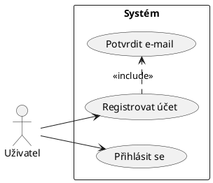
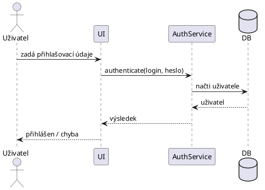
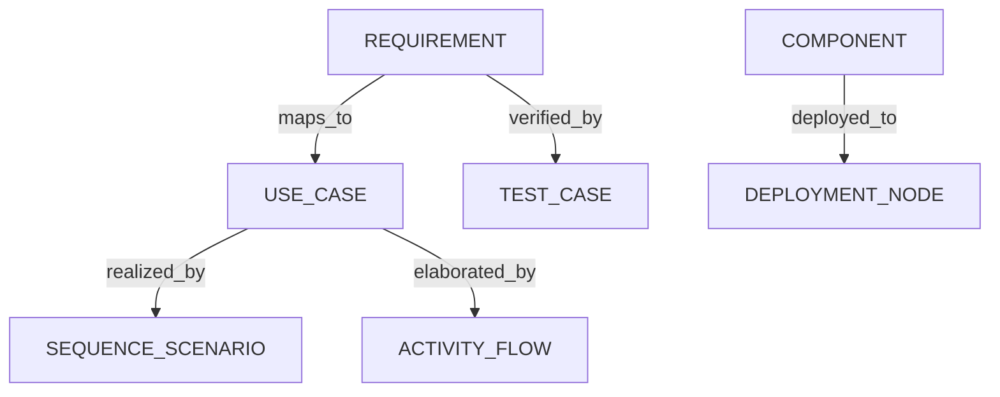

# Notace UML: nejlepší praktiky, tipy na aplikaci, druhy diagramů a případy jejich užití

## Výkonné shrnutí

UML je standardizovaný vizuální modelovací jazyk spravovaný organizací OMG, určený pro specifikaci, vizualizaci, konstrukci a dokumentaci softwarových i dalších systémů. K červnu 2026 OMG stále uvádí jako aktuální formální verzi UML 2.5.1 z prosince 2017; zároveň existuje aktivita „UML 2.6 Revision Task Force", ale nikoli samostatně publikovaná nová formální verze standardu. OMG zároveň publikuje nejen PDF specifikaci, ale i normativní strojově čitelné artefakty, například XMI pro metamodel, standardní profil a diagram interchange, což je důležité pro interoperabilitu nástrojů.[^1]

Pro praxi je podstatné rozlišit, že UML není vývojová metodika ani náhrada za kód. Je to jazyk a sada pohledů na systém. Nejvyšší návratnost v běžných projektech mívají diagramy případů užití, tříd, sekvenční diagramy, diagramy aktivit, stavové diagramy, komponentové a nasazovací diagramy; ostatní diagramy jsou velmi užitečné, ale častěji ve chvíli, kdy řešíš konkrétní architektonický nebo analytický problém. Empirické studie i průmyslová praxe ukazují, že UML se v organizacích používá selektivně a účelově, nikoli jako „modelovat všechno".[^2]

Z hlediska kvality modelů jsou nejdůležitější čtyři věci: modelovat jen to, co nese rozhodovací hodnotu; držet konzistentní naming a layout; udržet přiměřenou úroveň detailu; a zajistit návaznost mezi požadavky, designem, testy a případně kódem. Výzkum naznačuje, že kvalita layoutu i úroveň detailu mají měřitelný dopad na porozumění a údržbu, takže „hezky nakreslený diagram" není kosmetika, ale součást srozumitelnosti.[^3]

Prakticky: začni otázkou, kterou má diagram zodpovědět. Pro requirements použij use case a activity, pro doménu class, pro interakce sequence, pro stavové chování state machine, pro architekturu component a deployment. Diagramy verzuj stejně jako jinou dokumentaci, dělej nad nimi lehké review a u každého prvku přemýšlej, zda má jasného vlastníka a návaznost na další artefakty. Pokud tohle chybí, UML často degeneruje do „diagramového hřbitova".[^4]

## Co UML je a jak se vyvíjelo

UML vzniklo jako unifikace tehdy dominantních objektově orientovaných metod Booch, OMT a OOSE. IBM i původní specifikace UML popisují, že hlavními autory byli Grady Booch, James Rumbaugh a Ivar Jacobson, známí jako „Three Amigos". OMG přijalo UML 1.1 v prosinci 1997; od té doby standard prošel řadou revizí až k dnešní formální verzi 2.5.1.[^5]

Důležitý praktický rozdíl je mezi standardem OMG a ISO publikací. Na stránkách OMG je uvedeno, že UML 2.4.1 bylo formálně publikováno také jako ISO/IEC 19505-1 a 19505-2 v edici z roku 2012, zatímco aktuální formální specifikace v katalogu OMG je UML 2.5.1. Jinými slovy: pro běžnou praxi dnes dává smysl mluvit o UML 2.5.1, ale je užitečné vědět, že některé starší enterprise nástroje nebo dokumentace stále odkazují na ISO/IEC 19505 a UML 2.4.1.[^6]

OMG rozlišuje strukturální diagramy, behaviorální diagramy a interaction diagramy, přičemž interaction diagramy jsou specializovanou podmnožinou behaviorálních diagramů. V praxi se navíc běžně uvádí i profile diagram jako rozšiřující mechanismus pro přizpůsobení UML konkrétní platformě nebo doméně. To je důležité, protože ne každý tým potřebuje „celé UML"; většina týmů pracuje se stabilním jádrem několika diagramů a zbytek používá jen selektivně.[^7]

### Vývoj UML podle OMG

| Rok | Verze |
|-----|-------|
| 1997 | UML 1.1 adoptováno OMG |
| 1999 | UML 1.2 |
| 2000 | UML 1.3 |
| 2001 | UML 1.4 |
| 2003 | UML 1.5 |
| 2005 | UML 2.0 |
| 2007 | UML 2.1.2 |
| 2009 | UML 2.2 |
| 2010 | UML 2.3 |
| 2011 | UML 2.4.1 |
| 2015 | UML 2.5 |
| 2017 | UML 2.5.1 |
| 2026 | OMG stále uvádí 2.5.1 jako latest formal |

Časová osa výše vychází z historie verzí na stránkách OMG. Pro nástrojovou interoperabilitu je důležité i to, že OMG publikuje normativní XMI artefakty pro metamodel a UML Diagram Interchange; to je formální základ pro export/import modelů, i když skutečná interoperabilita mezi nástroji je v praxi stále něco, co je třeba pilotně ověřovat.[^8]

## Druhy diagramů a jejich užití

Níže uvedená tabulka syntetizuje klasifikaci diagramů podle OMG a jejich běžné použití podle dokumentace IBM, Microsoft a specializovaných referenčních průvodců k UML. Je dobré ji číst jako rozhodovací mapu: ne „co všechno UML umí", ale „kdy který diagram skutečně pomáhá".[^9]

| Diagram | Co ukazuje | Typické prvky a notace | Kdy ho použít | Hlavní výhoda | Hlavní nevýhoda |
|---------|------------|------------------------|---------------|---------------|-----------------|
| Use case | Externí cíle a interakce se systémem | aktér, use case, `<<include>>`, `<<extend>>`, generalizace | při vymezování scope a funkčních požadavků | srozumitelné pro business stakeholdery | neukazuje interní logiku |
| Activity | Workflow a tok řízení či dat | akce, control flow, object flow, rozhodnutí, fork/join, partitions | pro procesy, scénáře, orchestrace kroků | dobře odhalí chybějící větve a paralelismus | rychle se přeplní detailem |
| Class | Statickou strukturu systému | třída, atributy, operace, asociace, multiplicity, generalizace | pro doménní model a návrh objektů | nejlepší pro strukturu a vocabularium domény | snadno sklouzne do pseudo-kódu |
| Object | Konkrétní instanční snapshot | objekty, sloty, links | když chceš ověřit konkrétní konfiguraci instancí | výborné pro validaci designu | méně užitečné jako dlouhodobá dokumentace |
| Sequence | Pořadí zpráv v čase | lifeline, message, activation, combined fragment | pro scénář „co se stane krok za krokem" | přesně ukáže interakce a časové pořadí | hůř se čte ve větším rozsahu |
| Communication | Síť spolupráce objektů | lifelines/roles, pořadí zpráv, vazby | když je důležitější topologie spolupráce než čas | kompaktnější než sequence | slabší časová čitelnost |
| State machine | Reakce objektu na události ve stavech | stav, přechod, trigger, guard, entry/exit, final state | pro entity s bohatým životním cyklem | zachytí stavové podmínky a pravidla | zbytečné pro čistě lineární tok |
| Component | Logickou/modulární architekturu | komponenta, provided/required interface, dependency | pro služby, moduly, integrační rozhraní | dobré pro architekturu a ownership | neukazuje vnitřek komponent |
| Deployment | Fyzické nasazení za běhu | node, instance node, artifact, communication path | pro runtime topologii a prostředí | propojí software a infrastrukturu | nezachytí dobře chování |
| Package | Organizaci modelu a namespace | package, dependency/import | pro dělení velkých modelů | snižuje chaos a podporuje správu | nese málo doménní informace |
| Composite structure | Vnitřní strukturu jednoho classifieru | part, port, connector, role | když potřebuješ ukázat „co je uvnitř" třídy/komponenty | silné pro interní spolupráci částí | pro běžné týmy bývá složitější |
| Interaction overview | Přehled toku mezi interakcemi | interaction use, initial/final, rozhodnutí, odkazy na interakce | když máš více sekvenčních scénářů a potřebuješ jejich orchestraci | dobré pro navigaci mezi diagramy | málokdy potřeba v malém projektu |
| Timing | Změny stavů/událostí po časové ose | lifeline, state invariant, duration/time constraint | pro timeouty, latence, protokoly | výborné pro časová omezení | specializované, mimo běžné business projekty |
| Profile | Rozšíření UML pro doménu/platformu | stereotype, tagged value, constraint | když standardní UML nestačí | umožní standardizované rozšíření | snadno se nadužije a zkomplikuje model |

Z praktického hlediska se vyplatí mít jednoduchou heuristiku výběru. Pokud řešíš **co systém dělá pro okolí**, začni use case. Pokud řešíš **jak teče práce nebo logika**, použij activity. Pokud řešíš **jaké prvky systém obsahuje**, použij class nebo component. Pokud řešíš **jak spolu prvky komunikují v konkrétním scénáři**, použij sequence. Pokud řešíš **jak se jednotka chová v čase a při událostech**, použij state machine nebo timing. A pokud už tým tápe v organizaci modelu, obvykle chybí package diagram a jasné hranice.[^10]

## Notace a krátké ukázky

Na úrovni notace je užitečné znát několik „gramatických" prvků UML napříč diagramy. Třída se běžně zobrazuje jako obdélník s přihrádkami; asociace jako čára mezi prvky, na jejichž koncích lze uvést multiplicitu; generalizace používá šipku s dutým trojúhelníkem; závislost je typicky přerušovaná šipka; a kompozice/agregace jsou vyjádřeny diamantem, přičemž plný diamant značí kompozici. V interakčních diagramech se pracuje s lifelines a messages; v diagramu aktivit s akcemi, control flow, object flow, pins a partitions; ve state machine se stavy, přechody, triggery a guardy; v profile diagrams se stereotypy, tagged values a constraints.[^11]

Use case model je silný hlavně tehdy, když zůstane na úrovni cíle aktéra a nesnaží se suplovat detailní workflow. IBM i Microsoft u use case diagramů zdůrazňují, že jde o externí pohled na systém; Scott Ambler doporučuje pojmenovávat use cases silným slovesem a doménovou terminologií. To je malá věc, ale v praxi dramaticky zvyšuje čitelnost.[^12]



Sekvenční diagram je vhodný pro konkrétní scénář, ne pro celý systém. IBM výslovně popisuje sequence diagram jako zobrazení posloupnosti zpráv mezi objekty v interakci; combined fragments pak pomáhají zachytit podmínky, alternativy nebo smyčky. Když se tým snaží do jednoho sequence diagramu nacpat všechny varianty use case, čitelnost zpravidla kolabuje.[^13]



Pro traceability a komunikaci se stakeholdery někdy pomůže vedle UML udržet i jednodušší datový či vazební pohled. Následující pomocný ER náhled není UML, ale dobře ukazuje, jak může tým přemýšlet o návaznosti mezi požadavky, use cases, designem a testy. To je v souladu s doporučeními OSLC a s praxí IBM pro spojování požadavků, modelových prvků a kódu.[^14]



## Nejlepší praktiky a anti-patterny

Scott Ambler, Agile Modeling i empirická práce Marian Petre se v zásadě potkávají v jednom bodě: model je prostředek komunikace a rozhodování, ne cíl sám o sobě. Z toho plyne základní pravidlo: modeluj jen to, co zvyšuje porozumění, snižuje riziko nebo usnadňuje rozhodnutí. Pokud diagram nic z toho nedělá, je kandidátem na smazání.[^15]

Výzkum zároveň ukazuje, že kvalita layoutu a zvolená úroveň detailu nejsou marginálie. Rozložení prvků ovlivňuje porozumění diagramům a úroveň detailu ovlivňuje výkon údržbových úloh. Praktický důsledek je nepohodlný, ale důležitý: „více detailu" automaticky neznamená „lepší UML". Často je lepší několik menších abstraktních diagramů než jeden technicky přesný, ale nečitelný plakát.[^16]

Níže je kontrolní checklist, který funguje dobře pro analytickou i architektonickou praxi. Vychází z Agile Modeling, diagramming style guidelines, IBM doporučení pro modely a z práce kolem traceability.[^17]

| Oblast | Co dělat | Proč | Typický anti-pattern |
|--------|----------|------|----------------------|
| Účel diagramu | Před kreslením formulovat jednu otázku, kterou má diagram zodpovědět | drží scope a snižuje šum | „diagram pro diagram" |
| Naming | Používat konzistentní konvence a doménové názvy; use cases pojmenovávat slovesem | roste srozumitelnost a traceability | vágní názvy typu „Zpracování" |
| Úroveň detailu | Modelovat „just enough" pro rozhodnutí | zamezí pseudo-přesnosti | přetížení atributy, visibility, technickými detaily |
| Granularita | Preferovat více menších diagramů před jedním velkým | lepší čitelnost a review | „enterprise wallpaper" |
| Layout | Minimalizovat křížení čar, držet konzistentní směr a seskupení | porozumění je rychlejší | diagram bez vizuální hierarchie |
| Stereotypy | Používat střídmě a konzistentně; někdy je lepší naming než stereotype | méně hluku v notaci | stereotype spam |
| Verze | Ukládat modely do repozitáře, měnit je přes review | omezuje zastarávání | soubory mimo governance |
| Traceability | Propojit requirement → use case → design → test | usnadní dopadovou analýzu | ruční tabulky bez vazeb |
| Nástroje | Volit nástroj podle cíle: semantic modeler vs docs-as-code vs whiteboard | snižuje nástrojové tření | kreslit vše v libovolném editoru bez pravidel |
| Životnost | Průběžně rozhodovat, co udržovat a co archivovat | model má být živý | diagramový hřbitov |

Za nejčastější anti-patterny bych v obecné praxi považovala zejména čtyři. První je **overmodeling**: tým kreslí všechno a nic není aktuální. Druhý je **pseudo-precision**: třídní diagram vypadá „přesně", ale nikdo neví, proč tam je polovina atributů. Třetí je **mix úrovní abstrakce**: business proces, technická architektura i implementační detail v jednom obrázku. Čtvrtý je **stale documentation**: diagramy se neaktualizují a ztrácí důvěru. Tyto závěry jsou do značné míry inferencí z toho, že praxe používá UML selektivně, výzkum potvrzuje význam srozumitelnosti a style guides doporučují jednoduchost a standardizaci.[^18]

## Aplikace v týmech a traceability

V týmu se UML nejlépe osvědčuje jako lehký, průběžně aktualizovaný modelovací workflow napojený na delivery, nikoli jako samostatná dokumentační disciplína. IBM výslovně rozlišuje modely různých úrovní detailu a OSLC specifikace dávají základ pro propojení životního cyklu artefaktů. Prakticky to znamená: modely musí být připojené k backlogu, review, testům a release změnám.[^19]

```text
Požadavek nebo user story → Use case nebo activity → Class nebo component
→ Sequence nebo state machine → Deployment a test cases → Review a aktualizace modelu
```

Dobře funguje tento minimalistický režim. V discovery fázi udělat use case diagram a případně activity diagram pro hlavní tok. Při stabilizaci domény vytvořit class diagram a package strukturu. U rizikových scénářů doplnit sequence diagramy. U entit se složitým životním cyklem doplnit state machine. Před release nebo významnou architektonickou změnou udělat component a deployment diagram. Vše ostatní jen tehdy, když odpovídá na konkrétní otázku. To je velmi v souladu s agilním modelováním, kde modely mohou být i jednoduché skici, pokud nesou správnou informaci.[^20]

Traceability je místo, kde UML přestává být „jen obrázek". IBM uvádí, že traceability může spojovat požadavky, modelové prvky i kód, a OSLC Requirements Management standard definuje otevřený způsob, jak lifecycle artefakty propojit přes webová rozhraní. V menších týmech stačí jednoduchá matice nebo naming/linking konvence. Ve větších týmech je lepší mít živé odkazy mezi requirement položkami, use cases, komponentami a test cases.[^21]

Důležitá je i disciplína review. Diagram review má být kratší než code review a má zodpovědět tři otázky: je scope správně, odpovídá diagram realitě a chybí někomu klíčová vazba. Pokud je diagram tak velký, že review trvá neúměrně dlouho, je to indikace, že potřebuje rozpadnout. Výzkum o layout quality i praxe agilního modelování dávají této strohosti dobrý základ.[^22]

## Nástroje, pluginy a doporučené zdroje

Nástroje je užitečné rozdělit do tří kategorií: plnohodnotné modelery se sémantikou modelu, diagramming tools, a docs-as-code nástroje. Když tým potřebuje validaci modelu, profily, repository a bohaté traceability vazby, sáhne spíše po Papyrus, Enterprise Architect, Visual Paradigm nebo Modelio. Když potřebuje rychlou vizualizaci a kolaboraci, je vhodnější draw.io. Když chce mít diagramy ve wiki, repozitáři a CI/CD dokumentaci, vyhrávají PlantUML a Mermaid. To je analytický závěr nad oficiálními produktovými stránkami níže.[^23]

| Nástroj | Typ | Klíčové vlastnosti | Silné stránky | Omezení |
|---------|-----|--------------------|---------------|---------|
| Eclipse Papyrus | modeler | editory pro všechny UML diagramy, orientace na OMG UML, desktop i web varianty | nejblíže „spec-first" modelování, vhodné pro profily a formalismus | vyšší komplexita a learning curve |
| Sparx Enterprise Architect | modeler | multi-user prostředí, UML 2.5-based podpora, reporting a dokumentace | silný pro enterprise architekturu a týmovou správu modelů | proprietární a robustní až těžkopádný |
| Visual Paradigm | modeler / online suite | UML 2.x, syntax checks, online i desktop, šablony | dobrý kompromis mezi formalismem a použitelností | komerční licencování |
| Modelio | open-source modeler | UML, BPMN, SysML a consistency-checking | otevřenější modelovací prostředí s širšími standardy | menší ekosystém než největší komerční hráči |
| PlantUML | docs-as-code | textový zápis, podpora mnoha UML diagramů | skvělé pro verzování v Git a rychlé generování | není to plnohodnotné centrální model repository |
| Mermaid | docs-as-code | class, state, sequence + flowchart/timeline a další syntaxe v Markdown ekosystému | ideální do dokumentace, wiki, README a knowledge base | pouze subset UML, slabší sémantika |
| draw.io / diagrams.net | diagramming | open source, bez loginu, real-time collaboration, Confluence/Jira ekosystém | rychlá vizualizace a týmová spolupráce | UML je spíše kreslené než sémanticky řízené |

Tabulka vychází z oficiálních stránek jednotlivých produktů a jejich dokumentace. Papyrus explicitně deklaruje editory pro všechny UML diagramy; Enterprise Architect se prezentuje jako UML 2.5-based multi-user nástroj; Visual Paradigm uvádí UML 2.x a syntax checking; Modelio podporuje UML/BPMN/SysML a consistency checking; PlantUML je textový „diagram as code" nástroj; Mermaid oficiálně dokumentuje zejména class/state/sequence syntaxi a draw.io staví na otevřeném diagrammingu a integracích pro týmovou spolupráci.[^24]

Jako doporučené klíčové zdroje bych vybrala zejména tyto: oficiální katalog a specifikaci UML od OMG pro definice a verze; IBM UML docs pro praktické vysvětlení diagramů a traceability; Scott Ambler pro style guidelines; Microsoft Visio stránky v češtině jako rychlý český referenční materiál k běžným diagramům; a oficiální dokumentaci Papyrus, PlantUML a Mermaid při volbě nástroje.[^25]

### Doporučené odkazy k dalšímu čtení

- **OMG UML 2.5.1 specification a historie verzí** – autoritativní zdroj ke standardu, verzi a normativním dokumentům.[^26]
- **OMG What is UML** – rychlý přehled kategorií diagramů a jejich rozdělení.[^27]
- **IBM UML docs** – srozumitelná, ale stále poměrně rigorózní dokumentace k use case, sequence, component, state, timing a dalším diagramům.[^28]
- **Scott Ambler: The Elements of UML Style / Agile Modeling** – velmi užitečné pro naming, layout, úroveň detailu a praktické používání UML v agilním prostředí.[^29]
- **Microsoft Visio UML v češtině** – dobrý český referenční doplněk pro běžné diagramy a jejich základní účel.[^30]
- **Papyrus, PlantUML, Mermaid, draw.io** – oficiální zdroje pro výběr nástroje podle způsobu práce týmu.[^31]

## Závěr

Celkový závěr je poměrně přímočarý: UML je pořád velmi užitečné, když se používá selektivně, s jasným účelem a s disciplinovanou správou modelů. Selhává tehdy, když se z něj stane samoúčelná dokumentační vrstva oddělená od rozhodování a delivery. Pokud bych měla z celé rešerše vytáhnout jedinou praktickou větu, pak tuto: **nevybírej diagram podle toho, co „se má dělat", ale podle otázky, kterou potřebuješ zodpovědět teď.** Tento postoj podporují jak standard a průmyslové průvodce, tak empirická zjištění z reálné praxe.[^32]

## Zdroje

[^1]: About the Unified Modeling Language Specification Version 2.5.1 — https://www.omg.org/spec/UML/2.5.1/About-UML
[^2]: Creating use-case diagrams (IBM) — https://www.ibm.com/docs/en/dma?topic=diagrams-creating-use-case
[^3]: On the impact of layout quality to understanding UML diagrams: Diagram type and expertise — https://www.researchgate.net/publication/271494842_On_the_impact_of_layout_quality_to_understanding_UML_diagrams_Diagram_type_and_expertise
[^4]: Create the use-case model (IBM) — https://www.ibm.com/docs/en/rational-soft-arch/9.7.0?topic=system-create-use-case-model
[^5]: An introduction to the Unified Modeling Language (IBM) — https://developer.ibm.com/articles/an-introduction-to-uml/
[^6]: Unified Modeling Language™ (UML®) — https://www.omg.org/spec/UML/
[^7]: What is UML? (OMG) — https://www.omg.org/uml/what-is-uml.htm
[^8]: About the Unified Modeling Language Specification Version 2.5.1 — https://www.omg.org/spec/UML/2.5.1/About-UML
[^9]: What is UML? (OMG) — https://www.omg.org/uml/what-is-uml.htm
[^10]: Creating use-case diagrams (IBM) — https://www.ibm.com/docs/en/dma?topic=diagrams-creating-use-case
[^11]: UML Class Diagrams – Graphical Notation Reference — https://www.uml-diagrams.org/class-reference.html
[^12]: Create the use-case model (IBM) — https://www.ibm.com/docs/en/rational-soft-arch/9.7.0?topic=system-create-use-case-model
[^13]: Sequence diagrams (IBM) — https://www.ibm.com/docs/hr/rsas/7.5.0?topic=uml-sequence-diagrams
[^14]: OSLC Requirements Management Version 2.1, Part 1 — https://docs.oasis-open-projects.org/oslc-op/rm/v2.1/requirements-management-spec.html
[^15]: The Elements of UML Style – Improve Your Diagrams — https://scottambler.com/the-elements-of-uml-style/
[^16]: On the impact of layout quality to understanding UML diagrams — https://www.researchgate.net/publication/271494842_On_the_impact_of_layout_quality_to_understanding_UML_diagrams_Diagram_type_and_expertise
[^17]: General Diagramming Guidelines – Agile Modeling — https://agilemodeling.com/style/general.htm
[^18]: UML in Practice – Open Research Online — https://oro.open.ac.uk/35805/8/UML%20in%20practice%208.pdf
[^19]: UML models and diagrams (IBM) — https://www.ibm.com/docs/en/rational-soft-arch/9.7.0?topic=diagrams-uml-models
[^20]: Agile Modeling Home – The Agile Modeling (AM) Method — https://agilemodeling.com/
[^21]: Traceability in UML models (IBM) — https://www.ibm.com/docs/zh-tw/SS4JE2_7.5.5/com.ibm.xtools.traceability.doc/topics/ctraceability.html
[^22]: On the impact of layout quality to understanding UML diagrams — https://www.researchgate.net/publication/271494842_On_the_impact_of_layout_quality_to_understanding_UML_diagrams_Diagram_type_and_expertise
[^23]: Eclipse Papyrus™ Modeling environment — https://eclipse.dev/papyrus/
[^24]: Eclipse Papyrus™ Modeling environment — https://eclipse.dev/papyrus/
[^25]: About the Unified Modeling Language Specification Version 2.5.1 — https://www.omg.org/spec/UML/2.5.1/About-UML
[^26]: About the Unified Modeling Language Specification Version 2.5.1 — https://www.omg.org/spec/UML/2.5.1/About-UML
[^27]: What is UML? (OMG) — https://www.omg.org/uml/what-is-uml.htm
[^28]: Creating use-case diagrams (IBM) — https://www.ibm.com/docs/en/dma?topic=diagrams-creating-use-case
[^29]: The Elements of UML Style – Improve Your Diagrams — https://scottambler.com/the-elements-of-uml-style/
[^30]: Diagramy UML ve Visiu (Microsoft) — https://support.microsoft.com/cs-cz/visio/uml-diagrams-in-visio
[^31]: Eclipse Papyrus™ Modeling environment — https://eclipse.dev/papyrus/
[^32]: UML in Practice – Open Research Online — https://oro.open.ac.uk/35805/8/UML%20in%20practice%208.pdf
