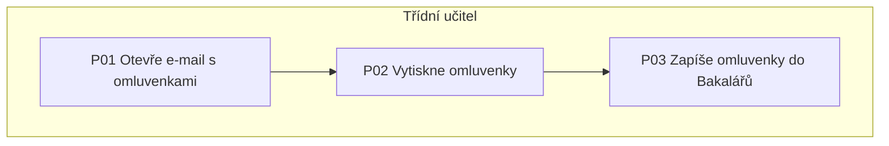

# Diagram procesu (jen na vyžádání)

Diagram je volitelný další krok. Po dokončení mapy ho jen nabídni, například: „Chcete, abych z této mapy připravil(a) i vývojový diagram nebo diagram s drahami podle aktérů?“ Vytvoř ho, až když o něj uživatel požádá.

## Zásady

- Diagram odpovídá mapě 1:1: stejná označení kroků (P01, P02…) a rozhodnutí (D01…), žádné nové kroky navíc.
- Zvol zápis podle účelu:
  - **vývojový diagram** stačí pro lineární průběh s malým počtem rozhodnutí,
  - **diagram s drahami podle aktérů** (každý aktér má svůj pruh), když je potřeba ukázat více rolí a předávky mezi nimi,
  - **BPMN** (standardní zápis podnikových procesů) jen u složitého procesu – více typů událostí, souběžné větve, potřeba formální dokumentace nebo předání IT týmu kvůli automatizaci.
- Modeluj jen tolik detailu, kolik odpovídá na konkrétní otázku. Přeplněný diagram nikdo neudržuje.
- Konzistentní pojmenování (sloveso + předmět) a jasně viditelní aktéři.
- Výchozí volba je zápis v jazyce Mermaid (`flowchart TD` s blokem `subgraph` pro každého aktéra): dobře se ukládá a vkládá do dokumentace. Když nástroj Mermaid nevykreslí, nabídni textový popis nebo tabulku.

## Ukázka kostry (Mermaid)

