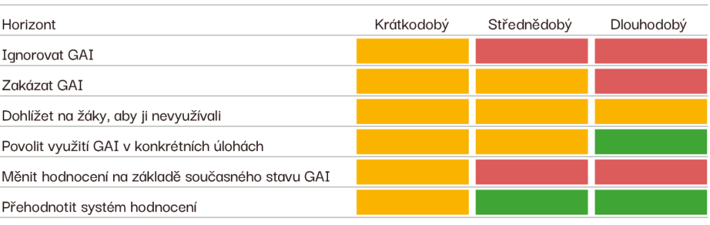

# Tvorba pravidel pro využívání AI

Žáci AI používají, ať to škola dovolí, nebo ne. Pravidla nejsou o zákazu, ale o tom, **kdy a jak AI učení pomáhá a kdy ho nahrazuje**. A o tom, aby všichni — učitelé, žáci i rodiče — věděli, co platí.

## Jakou strategii zvolit

Jason Lodge z University of Queensland porovnal, jak obstojí různé přístupy škol k AI v čase:

- **Ignorovat nebo zakázat** — dlouhodobě neudržitelné. AI je součástí běžných nástrojů a vyhledávačů.
- **Povolit AI v konkrétních úlohách** — dobře funguje už teď.
- **Proměnit hodnocení** — v krátkodobém horizontu náročné, dlouhodobě nejživotaschopnější, protože schopnosti AI porostou.

V praxi to znamená: začněte jasnými pravidly pro konkrétní úlohy a souběžně měňte zadání a hodnocení.

## Postup v pěti krocích

1. **Zmapujte, co se děje.** Krátký dotazník pro učitele a žáky: kdo co používá, k čemu, s jakou zkušeností.
2. **Domluvte se na hodnotách.** Co chceme, aby se žáci naučili? Kde AI pomáhá, kde škodí? Vyjděte z hodnot a vize školy.
3. **Sepište pravidla** zvlášť pro učitele, žáky a rodiče — krátce a srozumitelně. Pomůže skill níže.
4. **Projednejte je** s učiteli, žákovským parlamentem a rodiči. Pravidla, která vzniknou v dialogu, se dodržují.
5. **Vyhodnocujte a aktualizujte** aspoň jednou za pololetí. Nástroje se mění rychle.

## Co by pravidla měla obsahovat

- **Které nástroje** škola doporučuje a s jakými účty (školní účty, věkové limity).
- **Ochrana dat** — žádné osobní údaje žáků v chatbotech.
- **Kdy AI smí žák použít** — ideálně u každé úlohy označit úroveň (viz níže).
- **Jak přiznat použití AI** — krátká poznámka, k čemu a jak.
- **Co je podvod** — vydávání výstupu AI za vlastní práci tam, kde to zadání nedovoluje.
- **Jak AI používají učitelé** — příprava, hodnocení (AI nikdy nerozhoduje o známce sama), komunikace.
- **Kdo se stará o aktualizaci** pravidel.

## Úrovně využití AI v úlohách

U každé úlohy žákům řekněte, jak smí AI použít. Inspirací je škála AI Assessment Scale Leona Furzeho, ze které vychází i našich [10 způsobů využití AI ve výuce](/funkce/prompty/zaci):

1. **Bez AI** — žák pracuje sám (například písemná práce ve třídě).
2. **AI pro plánování** — nápady, osnova, plán; samotnou práci dělá žák.
3. **AI pro spolupráci** — AI pomáhá při práci, žák ji vede a hodnotí.
4. **Plné využití AI** — AI je nástroj, hodnotí se, jak s ní žák pracoval.
5. **AI jako téma** — žák s AI tvoří nové nástroje a postupy.

## Doporučení NPI

Národní pedagogický institut vydal v roce 2025 doporučení **Jak na AI ve škole** pro ředitele, učitele, žáky i rodiče. Jsou dobrým základem pro vlastní pravidla.

[Doporučení pro ZŠ a SŠ →](/ve-vyuce/doporuceni-zs-ss)

## Skill: Školní pravidla

Skill vás provede tvorbou pravidel krok za krokem: zeptá se na oblasti, cílové skupiny a hodnoty školy, navrhne formulace, upozorní na rizika (příliš represivní nebo nevymahatelná pravidla) a poradí, jak je zavést. Má i režim přímo pro pravidla využívání AI.

[Skill Školní pravidla →](/skills/skolni-pravidla)

Potřebujete vysvětlit rodičům, proč škola AI zavádí? Použijte skill [Komunikace s rodiči](/skills/komunikace-s-rodici).
